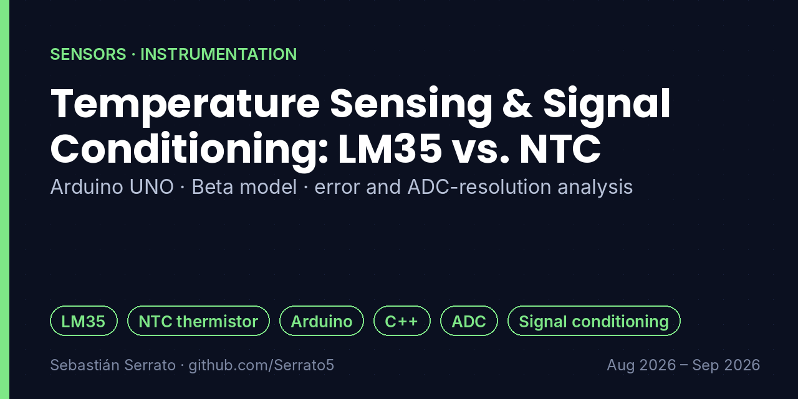

# Temperature Sensing & Signal Conditioning: LM35 vs. NTC

**Arduino UNO · Beta model · error and ADC-resolution analysis**

`LM35` `NTC thermistor` `Arduino` `C++` `ADC` `Signal conditioning`

## Overview

Experimental comparison of an active linear semiconductor sensor (LM35) and a passive non-linear resistive thermistor (NTC 10 kΩ), acquired with an Arduino UNO and linearized in C++.

## Key features

- **Transducer characterization:** Instrumental evaluation of the LM35 and an NTC 10 kΩ thermistor.
- **Conditioning and acquisition:** Voltage-divider circuit for the NTC and digitization of both outputs with the Arduino's 10-bit ADC (5 V reference).
- **Mathematical linearization:** Beta-model equation (B = 3950 K) programmed in C++ to compute temperature in kelvin and convert it to Celsius in real time.
- **Error analysis:** Absolute and relative errors calculated against a thermal reference; the NTC showed a faster thermal response under dynamic heating due to its lower mass.
- **ADC resolution:** Quantization analysis: going from a 10-bit ADC (≈0.49 °C/LSB) to a 12-bit ADC (≈0.12 °C/LSB) reduces the quantization step by 4×.
- **Hardware troubleshooting:** Diagnosis of real non-idealities, such as breadboard contact resistance and ground voltage drops that caused temporary reading inversions.

## How it works

## What I learned

- Linear vs. non-linear sensors and how to linearize them.
- Quantization step = full scale / 2ⁿ, and why more bits matter.
- Real circuits fail in ways simulations don't: contacts and ground drops.

## Project context

| | |
|---|---|
| Context | Universidad Surcolombiana |
| Dates | Aug 2026 – Sep 2026 |
| Area | Sensors · Instrumentation |

## Resumen en español

Comparación de un sensor LM35 (lineal, activo) y un termistor NTC de 10 kΩ (no lineal) con Arduino UNO: divisor de voltaje, ADC de 10 bits, linealización con el modelo Beta en C++, análisis de error frente a una referencia y de resolución del ADC (10 vs. 12 bits), y diagnóstico de problemas reales de montaje.

---

**About this repository:** the original source code and design files of this project were not preserved. This repository documents what was built, how it works and what I learned, based on my project records. It does not contain reconstructed code.

**Sobre este repositorio:** el código y los archivos originales de este proyecto no se conservaron. Aquí se documenta qué se construyó, cómo funciona y qué aprendí, sin código reconstruido.

**Author:** Sebastián Serrato Ramírez · Electronic Engineering student, Universidad Surcolombiana (Neiva, Colombia) · [LinkedIn](https://www.linkedin.com/in/sebaserrato) · [More projects](https://github.com/Serrato5)
